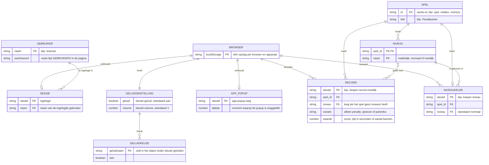

# ERD – Voetbal-website

De website heeft geen database. Alle gegevens staan in de browser (`localStorage`) of als vaste lijst in [index.html](index.html). Dit diagram laat zien welke gegevens er zijn en hoe ze bij elkaar horen.

## Welke sleutels horen bij welk spel

| Spel (sectie-id) | Niveaukeuze | Records | Waarde |
| --- | --- | --- | --- |
| Penaltyserie (`spel`) | – | `penalty-record`, `panenka-record` | score, hoger is beter |
| Hooghouden (`hooghouden`) | – | `hooghouden-record` | score, hoger is beter |
| Overkoppen (`koppen`) | – | `overkoppen-record` | score, hoger is beter |
| Omhaal-uitdaging (`omhaal`) | – | `omhaal-record` | score, hoger is beter |
| Jij bent de keeper (`redden`) | `keeper-niveau` | `keeper-record-makkelijk`, `keeper-record`, `keeper-record-moeilijk` | score, hoger is beter |
| Eén tegen één (`eentegeneen`) | `ee-niveau` | – | – |
| Vrije trap (`vrijetrap`) | – | `vrijetrap-record` | score, hoger is beter |
| Dribbelparcours (`dribbel`) | `dribbel-niveau` | `dribbel-record-makkelijk`, `dribbel-record`, `dribbel-record-moeilijk` | tijd in seconden, lager is beter |
| Schietwand (`schietwand`) | – | `schietwand-record` | score, hoger is beter |
| Voetbal-memory (`memory`) | `memory-niveau` | `memory-record-makkelijk`, `memory-record-normaal`, `memory-record-moeilijk` | aantal beurten, lager is beter |
| Dribbelrun (`dribbelrun`) | – | `dribbelrun-record` | score, hoger is beter |
| Vier op een rij (`vier`) | – | – | – |
| De Blockers (`blockers`) | – | `blockers-record` | score, hoger is beter |

## Goed om te weten

- Records, niveaus en geluidsinstellingen horen bij de **browser**, niet bij de gebruiker. Wie inlogt als een andere gebruiker ziet dezelfde records.
- De gebruikers staan als vaste lijst in de pagina; er is geen tabel waarin je gebruikers kunt toevoegen.
- De sessie is één waarde (`ingelogd`): er kan per browser maar één gebruiker tegelijk ingelogd zijn.
